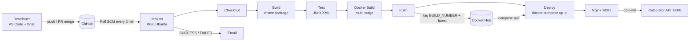

# SPE Calculator CI/CD

End-to-end CI/CD pipeline for a Calculator REST API
(CSE 816 - Software Production Engineering mini-project).

## Project overview

A Spring Boot REST API offering add, subtract, multiply and divide, delivered by an
automated pipeline. Every merge to `main` is built, tested, packaged into a Docker image,
published to Docker Hub and deployed with Docker Compose behind an Nginx reverse proxy.
A failing test stops the pipeline before anything is published or deployed.

## Architecture



## Technology stack

| Area | Technology |
|---|---|
| Language / framework | Java 17, Spring Boot 4.1.0, Spring Web MVC, Actuator |
| Build | Maven (Maven Wrapper, Maven 3.9.11) |
| Tests | JUnit 5, Spring MockMvc |
| Source control | Git, GitHub |
| CI/CD | Jenkins (declarative Jenkinsfile) |
| Containers | Docker (multi-stage), Docker Hub, Docker Compose |
| Reverse proxy | Nginx (stable-alpine) |

## Prerequisites

- Windows 11 with WSL 2 and Ubuntu 24.04
- JDK 17 and Git in Ubuntu
- Docker Desktop with WSL integration enabled for the Ubuntu distro
- Jenkins in Ubuntu (Jenkins itself needs JDK 21; builds use JDK 17)
- A Docker Hub account and an SMTP account for Jenkins email

## Repository structure

```
.
├── Dockerfile                 multi-stage build, non-root runtime
├── Jenkinsfile                declarative pipeline
├── docker-compose.yml         API + Nginx on a custom network
├── nginx/nginx.conf           reverse proxy configuration
├── pom.xml                    Maven build
├── mvnw, mvnw.cmd, .mvn/      Maven Wrapper
└── src/
    ├── main/java/com/spe/calculator/
    │   ├── CalculatorApplication.java
    │   ├── controller/        REST endpoints
    │   ├── service/           arithmetic and input rules
    │   ├── dto/               response records
    │   └── exception/         error handling (HTTP 400 JSON)
    ├── main/resources/application.properties
    └── test/java/com/spe/calculator/   unit and MockMvc tests
```

## Local setup, build and test

```bash
./mvnw clean test                       # runs 30 tests, writes target/surefire-reports/*.xml
SERVER_PORT=9090 ./mvnw spring-boot:run # port 9090 because Jenkins uses 8080 on this machine
curl "http://localhost:9090/api/v1/add?a=2&b=3"
```

## API

| Method and path | Example |
|---|---|
| GET `/api/v1/add?a=2&b=3` | `{"operation":"add","a":2,"b":3,"result":5}` |
| GET `/api/v1/subtract?a=5&b=2` | `{"operation":"subtract","a":5,"b":2,"result":3}` |
| GET `/api/v1/multiply?a=2&b=3` | `{"operation":"multiply","a":2,"b":3,"result":6}` |
| GET `/api/v1/divide?a=6&b=2` | `{"operation":"divide","a":6,"b":2,"result":3}` |
| GET `/actuator/health` | `{"groups":["liveness","readiness"],"status":"UP"}` |

Errors are always HTTP 400 with one JSON shape:

```json
{"status":400,"error":"DIVISION_BY_ZERO","message":"Division by zero is not allowed","path":"/api/v1/divide"}
```

Error codes: `MISSING_PARAMETER`, `INVALID_PARAMETER`, `INVALID_INPUT`, `DIVISION_BY_ZERO`.

Limits: arithmetic uses `BigDecimal`. Each operand must satisfy |value| <= 1E15 and have at most
15 decimal places. Division is rounded HALF_UP to 10 decimal places, and trailing zeros are removed.

## Docker

```bash
docker build -t calculator-api:dev .
docker run -d --name calculator -p 9090:8080 calculator-api:dev
docker logs calculator --tail 20
curl "http://localhost:9090/actuator/health"
docker stop calculator && docker rm calculator
```

The image runs as the non-root user `spring`, exposes port 8080 and has a health check.

## Docker Compose

```bash
docker compose up -d      # API + Nginx; Nginx is published on host port 8081
docker compose ps
docker compose logs --tail 20
curl "http://localhost:8081/api/v1/add?a=2&b=3"
docker compose down
```

Variables (all optional): `DOCKERHUB_USER` (default `rishik0425`), `IMAGE_TAG` (default `latest`),
`HOST_PORT` (default `8081`). Containers talk by service name (`calculator-api`), because
`localhost` inside a container means that container itself.

## Jenkins pipeline setup

1. Install Jenkins from the stable apt repository in Ubuntu. It needs JDK 21, so install
   `openjdk-21-jdk-headless` and set `JAVA_HOME` for the service only with a systemd override.
2. Add the `jenkins` user to the `docker` group and restart Jenkins.
3. Install the suggested plugins, create an admin user and keep anonymous access off.
4. Add a credential: kind Username with password, ID `dockerhub-credentials`, password = a Docker Hub
   access token (Read & Write).
5. Configure SMTP under Manage Jenkins > System (Gmail: smtp.gmail.com, port 465, SSL, app password).
6. Create a Pipeline job `calculator-pipeline`: Pipeline script from SCM, Git, this repository,
   branch `*/main`, script path `Jenkinsfile`.
7. Trigger: Poll SCM `H/2 * * * *`. A GitHub webhook can be added through a temporary tunnel.

Stages: Checkout, Build, Test (JUnit published even on failure), Docker Build, Push, Deploy
(with health verification). Emails are sent on success and failure.

## Docker Hub image

Public repository: https://hub.docker.com/r/rishik0425/spe-calculator
Tags: the Jenkins build number (for example `6`) and `latest`.

```bash
docker run -d -p 9090:8080 rishik0425/spe-calculator:latest
```

## Troubleshooting

| Symptom | Cause and fix |
|---|---|
| Jenkins service fails with "older than the minimum required version (Java 21)" | Install JDK 21 and set `JAVA_HOME` in a systemd override for `jenkins.service` |
| `docker: command not found` in WSL | Docker Desktop is not running or WSL integration is off |
| Nginx container `unhealthy` | The health check must call `127.0.0.1`, because `localhost` resolves to IPv6 first |
| Jenkins "Unable to find Jenkinsfile" | The Jenkinsfile is not on the branch the job builds |
| Push does not start a build | Poll SCM is not enabled, or the webhook tunnel URL changed |
| Port 8080 in use | Jenkins owns 8080, so run the app on 9090 and publish Nginx on 8081 |

## Security considerations

- No secrets are committed. Docker Hub and SMTP credentials live only in Jenkins.
- The `docker` group is root-equivalent on the Docker host, so keep Jenkins local, with login required.
- The container runs as a non-root user, and only Nginx is published to the host.
- Actuator exposes only the `health` endpoint.
- A tunnel for webhooks exposes the Jenkins login page, so run it only while testing and delete the webhook afterwards.
- The notification address is stored in the `Jenkinsfile` of this public repository.